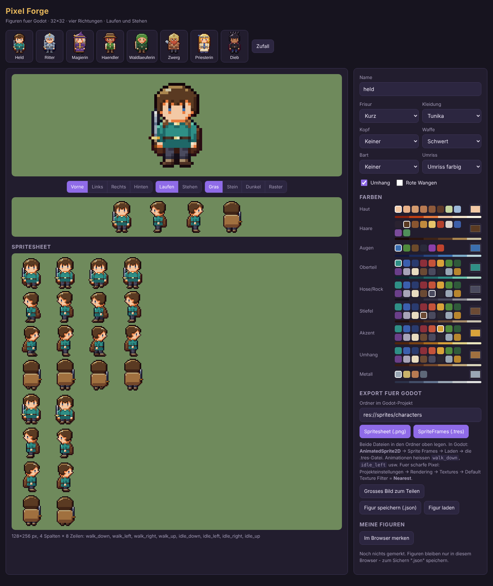

# Pixel Forge

Pixelart-Figuren fuer **Godot** direkt im Browser bauen: zusammenklicken, sofort laufen sehen, als
Spritesheet plus fertige `SpriteFrames`-Datei herunterladen.

- **32×32 Pixel**, vier Richtungen (vorne, links, rechts, hinten)
- **Laufen** (4 Frames) und **Stehen** (2 Frames, Atmen)
- Kein KI-Glueck, keine GPU, keine Installation: jede Figur entsteht aus Code und sieht in jedem Frame
  gleich aus


- Acht Vorlagen (Held, Ritter, Magierin, Haendler, Waldlaeuferin, Zwerg, Priesterin, Dieb) und ein Zufallsknopf

## Starten

Es ist eine reine HTML-Seite ohne Build-Schritt. Weil sie JavaScript-Module laedt, muss sie ueber
einen kleinen Webserver laufen (Doppelklick auf `index.html` reicht nicht):

```bash
python -m http.server 8000
# dann http://localhost:8000 im Browser oeffnen
```

**Online stellen (kostenlos):** GitHub → Repo → *Settings* → *Pages* → *Deploy from a branch* →
`main` / `(root)` → Speichern. Nach ein, zwei Minuten laeuft das Tool unter
`https://<name>.github.io/pixel-forge/`.

## In Godot benutzen

1. **Spritesheet (.png)** und **SpriteFrames (.tres)** herunterladen und beide in den Ordner legen,
   der im Tool eingetragen ist (Standard `res://sprites/characters`).
2. Projekteinstellungen → Rendering → Textures → *Default Texture Filter* = **Nearest**
   (sonst werden die Pixel unscharf).
3. Einen `AnimatedSprite2D` anlegen → *Sprite Frames* → *Laden* → die `.tres`-Datei.

Animationen: `walk_down`, `walk_left`, `walk_right`, `walk_up`, `idle_down`, `idle_left`,
`idle_right`, `idle_up`. Beispiel fuer eine Spielfigur:

```gdscript
extends CharacterBody2D

@export var speed := 80.0
@onready var sprite: AnimatedSprite2D = $AnimatedSprite2D
var facing := "down"

func _physics_process(_delta):
	var dir := Input.get_vector("ui_left", "ui_right", "ui_up", "ui_down")
	velocity = dir * speed
	move_and_slide()
	if dir != Vector2.ZERO:
		if abs(dir.x) > abs(dir.y):
			facing = "right" if dir.x > 0 else "left"
		else:
			facing = "down" if dir.y > 0 else "up"
		sprite.play("walk_" + facing)
	else:
		sprite.play("idle_" + facing)
```

Getestet mit Godot 4.3: die `.tres` laedt alle acht Animationen mit den richtigen Ausschnitten.

## Wie die Figuren entstehen

| Datei | Aufgabe |
| --- | --- |
| `src/palette.js` | Macht aus einer Farbe eine **Farbleiter** mit sechs Toenen: Schatten kuehler und satter, Lichter waermer. Das ist der Hauptgrund, warum es nach gemalter Pixelart aussieht. |
| `src/painter.js` | Mal-Gerüst: Formen werden als Teile gemalt (Kopf, Haare, Arm ...), die **Schattierung rechnet der Painter selbst** (Licht von links oben, Teile davor werfen Schatten). Danach farbiger Umriss. |
| `src/character.js` | Die Figur: Formen je Richtung, Frisuren, Kleidung, Huete, Waffen, Laufposen, Vorlagen. |
| `src/export.js` | Spritesheet und Godot-`SpriteFrames`. |
| `src/app.js` | Die Oberflaeche. |
| `gallery.html` | Alle Vorlagen auf einen Blick (zum Pruefen nach Aenderungen). |

## Lizenz

MIT, siehe [LICENSE](LICENSE). Die erzeugten Bilder gehoeren dir und duerfen in eigenen (auch
kommerziellen) Spielen verwendet werden.
